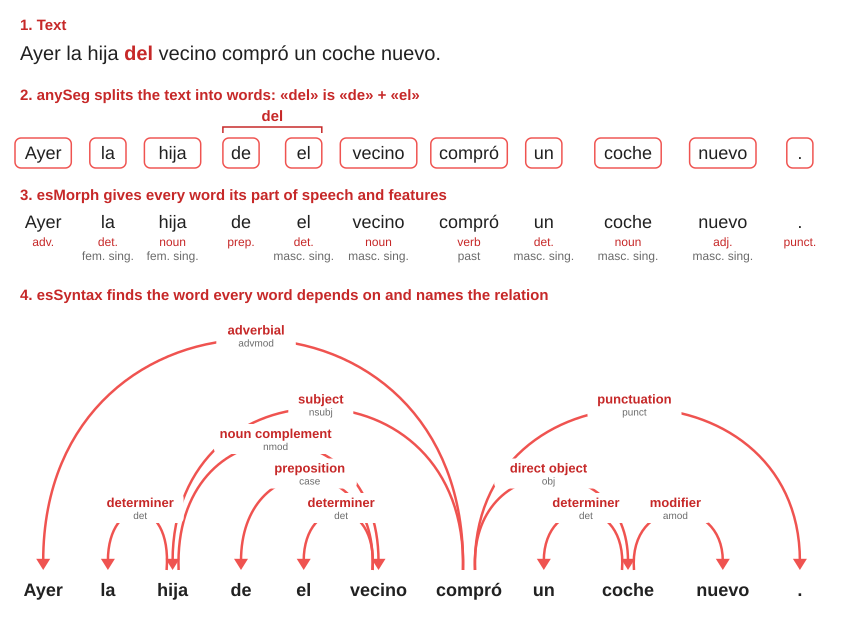

# esSyntax


**esSyntax** es un analizador sintáctico de dependencias del español: un núcleo en Rust con API para Python. Para cada palabra de una oración el analizador encuentra la palabra de la que depende y la relación entre ambas en la anotación de [Universal Dependencies](https://universaldependencies.org/). El segmentador [anySeg](https://sergeyshk.github.io/anySeg/) divide el texto en oraciones y palabras, y el analizador morfológico [esMorph](https://sergeyshk.github.io/esMorph/es/) da las categorías gramaticales y los rasgos.

## Funciones

<div class="grid cards" markdown>

-   :material-file-tree:{ .lg .middle } __Analizador__

    ---

    El núcleo y la relación de cada palabra de un texto, de un documento de anySeg o de una oración con sus etiquetas; muchas oraciones a la vez, las probabilidades de los núcleos y de las relaciones, hilos sin el GIL

    [:octicons-arrow-right-24: Analizador](parser.md)

-   :material-console:{ .lg .middle } __Línea de comandos__

    ---

    El comando `essyntax`: CoNLL-U a partir de texto o de CoNLL-U con categorías gramaticales y rasgos, archivos y flujos por párrafos

    [:octicons-arrow-right-24: El comando essyntax](cli.md)

-   :material-graph-outline:{ .lg .middle } __Modelo__

    ---

    Una BiLSTM sobre las palabras y sus etiquetas de esMorph, núcleos biafines y un árbol con una sola raíz, entrenada con UD Spanish AnCora y GSD; 2.9 MB dentro del paquete

    [:octicons-arrow-right-24: Modelo](model.md)

-   :material-speedometer:{ .lg .middle } __Comparación__

    ---

    Calidad y velocidad frente a otros analizadores sintácticos del español

    [:octicons-arrow-right-24: Comparación](performance.md)

</div>

## Cómo funciona { #how }

Una oración pasa por tres pasos: el segmentador anySeg divide el texto en tokens y sus palabras (`del` es `de` + `el`), el analizador morfológico esMorph da a cada palabra su categoría gramatical y sus rasgos - género, número, persona, modo - y esSyntax usa las palabras y sus etiquetas para encontrar de qué palabra depende cada palabra y cómo: el sujeto depende del verbo, un determinante de su sustantivo, una preposición de la palabra que introduce.



## Instalación

Se requiere Python 3.11 o superior.

``` bash
pip install essyntax
```

Los paquetes precompilados, la compilación desde el código fuente y el crate de Rust se describen en la página de [instalación](installation.md).

## Inicio rápido

=== "Código"

    ``` python
    from essyntax import Parser

    parser = Parser()
    document = parser.parse_text("Mi madre lava la ropa.")
    [(word.form, word.head, word.deprel) for word in document.words]
    ```

=== "Resultado"

    ```
    [('Mi', 2, 'det'), ('madre', 3, 'nsubj'), ('lava', 0, 'root'), ('la', 5, 'det'), ('ropa', 3, 'obj'), ('.', 3, 'punct')]
    ```

El núcleo es el número de una palabra en la oración empezando por 1, y la raíz tiene 0. Los métodos del analizador están en la página del [analizador](parser.md), y el [comando essyntax](cli.md) analiza archivos y flujos en CoNLL-U.
