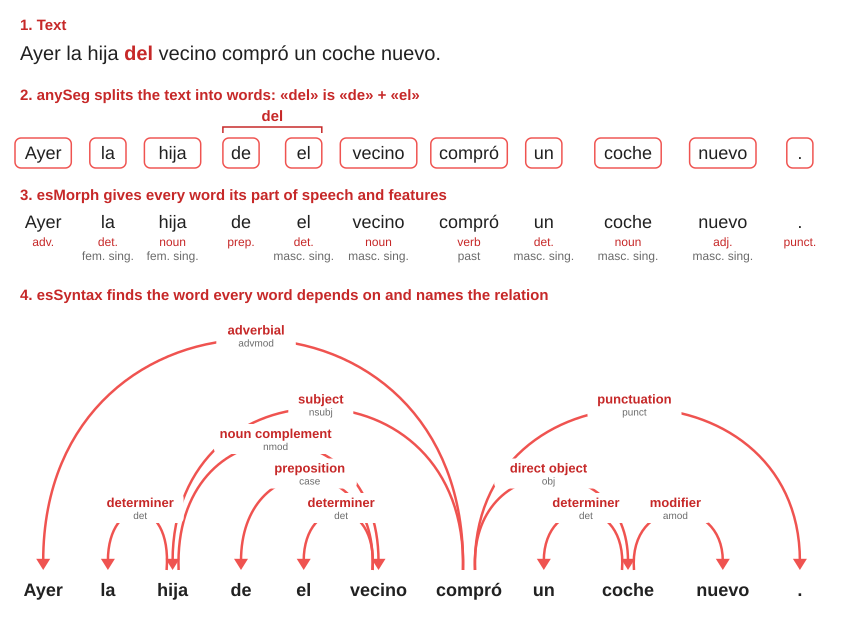

# esSyntax


**esSyntax** is a dependency parser of Spanish: a Rust core with a Python API. For every word of a sentence the parser finds its head and the relation between them in the [Universal Dependencies](https://universaldependencies.org/) annotation. The [anySeg](https://sergeyshk.github.io/anySeg/) segmenter splits the text into sentences and words, and the [esMorph](https://sergeyshk.github.io/esMorph/) morphological analyzer gives the parts of speech and features.

!!! warning "Work in progress"
    The API may change until version 0.1.0. Versions `0.1.0.devN` are published on TestPyPI.

## Features

<div class="grid cards" markdown>

-   :material-file-tree:{ .lg .middle } __Parser__

    ---

    The head and the relation of every word of a text, of an anySeg document or of a sentence with its tags; many sentences at once, the probabilities of the heads and the relations, threads without the GIL

    [:octicons-arrow-right-24: Parser](parser.md)

-   :material-console:{ .lg .middle } __Command line__

    ---

    The `essyntax` command: CoNLL-U from text or from CoNLL-U with parts of speech and features, files and streams by paragraphs

    [:octicons-arrow-right-24: The essyntax command](cli.md)

-   :material-graph-outline:{ .lg .middle } __Model__

    ---

    A BiLSTM over the words and their esMorph tags, biaffine heads and a tree with one root, trained on UD Spanish AnCora and GSD; 2.9 MB built into the package

    [:octicons-arrow-right-24: Model](model.md)

-   :material-speedometer:{ .lg .middle } __Comparison__

    ---

    Quality and speed compared with other parsers of Spanish

    [:octicons-arrow-right-24: Comparison](performance.md)

</div>

## How it works { #how }

A sentence goes through three steps: the anySeg segmenter splits the text into tokens and their words (`del` is `de` + `el`), the esMorph morphological analyzer gives every word its part of speech and features - gender, number, person, mood - and esSyntax uses the words and their tags to find which word every word depends on and how: the subject depends on the verb, a determiner on its noun, a preposition on the word it introduces.



## Installation

Python 3.11 or newer is required.

``` bash
pip install essyntax
```

Prebuilt wheels, building from source and the Rust crate are described on the [Installation](installation.md) page.

## Quick start

=== "Code"

    ``` python
    from essyntax import Parser

    parser = Parser()
    document = parser.parse_text("Mi madre lava la ropa.")
    [(word.form, word.head, word.deprel) for word in document.words]
    ```

=== "Result"

    ```
    [('Mi', 2, 'det'), ('madre', 3, 'nsubj'), ('lava', 0, 'root'), ('la', 5, 'det'), ('ropa', 3, 'obj'), ('.', 3, 'punct')]
    ```

The head is the number of a word in the sentence starting from 1, and the root has 0. The methods of the parser are on the [Parser](parser.md) page, and the [essyntax command](cli.md) parses files and streams into CoNLL-U.
