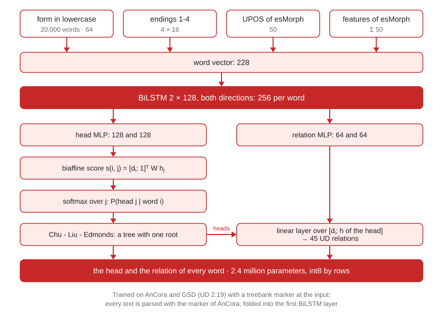
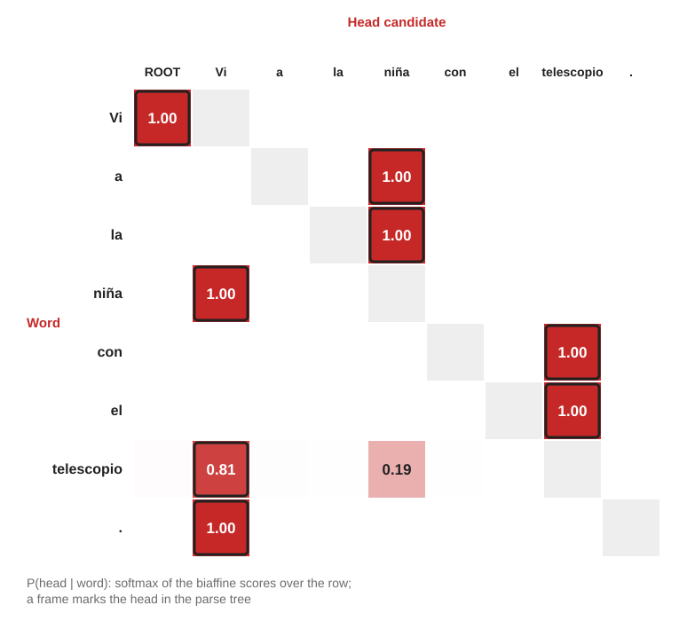

# Modelo

El modelo del paquete va dentro del módulo de extensión: no hace falta ningún archivo de pesos, y `Parser()` lo carga en unos 5 ms. La calidad y la velocidad frente a otros analizadores están en la página de [comparación](performance.md).

## Arquitectura { #architecture }

- **Entrada de una palabra** - la forma en minúsculas (las 20 mil formas más frecuentes de los datos de entrenamiento, un vector de 64; las demás formas son desconocidas), las terminaciones de 1 a 4 letras con una marca de comienzo de palabra (un vector de 16 cada una), y la categoría gramatical de UD y la suma de los vectores de sus pares de rasgos (50 cada uno), tal como los da esMorph en contexto.
- **Codificador** - una LSTM bidireccional, dos capas de 128 por sentido: cada palabra ve la oración entera.
- **Núcleos** - una puntuación biafín de cada par «palabra - candidato a núcleo» sobre proyecciones de 128, y el árbol con la mayor suma de puntuaciones y una sola raíz (el algoritmo de Chu - Liu - Edmonds), así que también son posibles los árboles no proyectivos.
- **Relaciones** - una puntuación lineal del par «dependiente - núcleo» sobre proyecciones de 64 para 45 relaciones de UD con subtipos.
- **Treebank** - en el entrenamiento la entrada de una palabra lleva además la marca del treebank de su oración, así que las convenciones de AnCora y de GSD no se mezclan. El modelo del paquete analiza todo texto como AnCora: la marca de AnCora va incluida en el sesgo de la primera capa de la LSTM.
- **Pesos** - 2.4 millones de parámetros, matrices en int8 por filas con una escala por fila; el archivo ocupa 2.9 MB con los vocabularios de formas y terminaciones.

## Elección del núcleo { #heads }

El modelo da a cada palabra una probabilidad para cada candidato a núcleo: el softmax de sus puntuaciones biafines sobre las palabras de la oración y la raíz. En `Vi a la niña con el telescopio.` el núcleo de `telescopio` no es seguro: `Vi` - el telescopio es el instrumento de ver, `obl` - recibe 0.81, y `niña` - la niña tiene el telescopio - recibe 0.19; todas las demás palabras tienen su núcleo con una probabilidad de 1.00. El árbol toma los núcleos más probables salvo que formen un ciclo o varias raíces; entonces Chu - Liu - Edmonds encuentra el mejor árbol con una sola raíz. Las probabilidades se devuelven con `probs=True` (véase [`parse`](parser.md#parse)); los números de la figura los calcula `scripts/figures.py` con el modelo del paquete.

## Entrenamiento { #training }

El modelo está entrenado con las partes de entrenamiento de los treebanks [UD Spanish AnCora](https://github.com/UniversalDependencies/UD_Spanish-AnCora) y [UD Spanish GSD](https://github.com/UniversalDependencies/UD_Spanish-GSD) de la versión 2.19 de UD: 453 mil palabras de noticias en AnCora y 383 mil palabras de textos de la web en GSD. Las palabras son las de los treebanks, y sus categorías gramaticales y rasgos los da esMorph 0.6.0 en contexto: así el modelo aprende con las etiquetas del mismo analizador que tiene el usuario, no con las de referencia. Dos tipos de ruido hacen al analizador robusto frente a los errores de etiquetado y a los rasgos que faltan: el 5 % de las palabras ambiguas recibe otro análisis de esMorph con otras etiquetas, y se quita el 10 % de los pares de rasgos; sin ningún rasgo en la entrada el LAS en AnCora dev baja unos 0.9 puntos.

El punto del entrenamiento se elige por el LAS en AnCora dev, y GSD dev sirve de control. De tres entrenamientos, el que tiene el mejor LAS en AnCora dev es el modelo del paquete: 89.42 en AnCora dev y 81.92 en GSD dev (`parser.sources["dev_las"]`).

`make model` reproduce el entrenamiento: `scripts/export_ud.py` descarga los treebanks y comprueba su SHA-256, y `scripts/train.py` con las versiones de los paquetes fijadas (`scripts/train.py.lock`) entrena el modelo y escribe los pesos en `data/es-syntax.bin`. En MPS y en GPU el entrenamiento no es determinista: repetirlo da pesos cercanos, pero no iguales. Junto con los pesos escribe `data/check.conllu` - el análisis de las 200 primeras oraciones de AnCora dev por el mismo modelo en PyTorch: una prueba del crate comprueba con él el paso hacia adelante en Rust.

## Calidad { #quality }

LAS en las partes de prueba de los treebanks de UD 2.19 (el script de evaluación de CoNLL 2018, con la puntuación), %:

| Entrada | AnCora | GSD | PUD | COSER |
| :------ | -----: | --: | --: | ----: |
| Texto a través de anySeg y esMorph | 89.25 | 80.95 | 81.97 | 65.52 |
| Palabras de referencia con etiquetas de esMorph | 89.44 | 81.68 | 82.21 | 67.03 |

La primera línea es lo que dan `parse_text` y el comando para un texto sin procesar; la segunda deja fuera los errores del segmentador. AnCora y GSD son los treebanks del entrenamiento; PUD (oraciones traducidas de noticias y de Wikipedia) lo anotó Google con la misma guía que GSD, y COSER (habla rural transcrita) es nuevo para el modelo.

## Convenciones { #conventions }

Las relaciones siguen la guía de [Universal Dependencies](https://universaldependencies.org/u/dep/) y, donde calla, las convenciones de AnCora, el mayor treebank del español. Un clítico dativo y un objeto indirecto con `a` son `obl:arg`, no `iobj`, como en los dos treebanks (`Le di el libro a María.`); `se` de una pasiva es `expl:pass` (`Se venden pisos.`), mientras que GSD marca casi todo `se` como `expl:pv`.

El modelo tiene un punto débil conocido: una oración corta con `a` y un sustantivo tras un verbo de movimiento (`Voy al cine.`) puede recibir `obj` para el sustantivo en lugar de `obl`.

## Modelo propio { #custom }

`Parser(path)` carga un modelo de un archivo del formato de esSyntax - por ejemplo, uno entrenado con `scripts/train.py` con otros datos. El archivo se comprueba al cargarlo: la firma, la versión del formato, la suma de comprobación y los tamaños de todos los pesos. Cómo se entrenó el modelo está en `parser.sources`, y sus relaciones en `parser.relations`.

## Licencia { #license }

El modelo está entrenado con datos bajo las licencias CC BY 4.0 (AnCora) y CC BY-SA 4.0 (GSD) y se distribuye bajo la licencia [CC BY-SA 4.0](https://creativecommons.org/licenses/by-sa/4.0/) ([LICENSE-MODEL.txt](https://github.com/SergeyShk/esSyntax/blob/master/LICENSE-MODEL.txt)); el código de esSyntax está bajo la licencia MIT.
