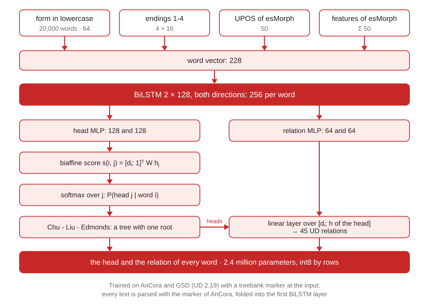
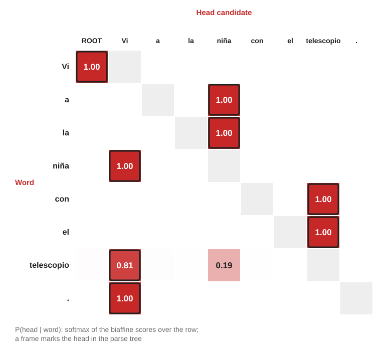

# Model

The package model is built into the extension module: no weights file is needed, and `Parser()` loads it in about 5 ms. Quality and speed compared with other parsers are on the [Comparison](performance.md) page.

## Architecture { #architecture }

- **Word input** - the form in lowercase (the 20 thousand most frequent forms of the training data, a vector of 64; other forms are unknown), the endings of 1 to 4 letters with a word-start mark (a vector of 16 each), and the UD part of speech and the sum of the vectors of its feature pairs (50 each), as esMorph gives them in context.
- **Encoder** - a bidirectional LSTM, two layers of 128 per direction: every word sees the whole sentence.
- **Heads** - a biaffine score of every pair "word - head candidate" over projections of 128, and the tree with the highest sum of scores and one root (the Chu - Liu - Edmonds algorithm), so non-projective trees are possible too.
- **Relations** - a linear score of the pair "dependent - head" over projections of 64 for 45 UD relations with subtypes.
- **Treebank** - in training the input of a word also has the marker of the treebank of its sentence, so the conventions of AnCora and GSD do not mix. The package model parses every text as AnCora: the marker of AnCora is folded into the bias of the first LSTM layer.
- **Weights** - 2.4 million parameters, matrices in int8 by rows with a scale per row; the file is 2.9 MB with the vocabularies of forms and endings.

## Choosing the head { #heads }

For every word the model gives a probability to each head candidate: the softmax of its biaffine scores over the words of the sentence and the root. In `Vi a la niña con el telescopio.` the head of `telescopio` is not certain: `Vi` - the telescope is the instrument of seeing, `obl` - gets 0.81, and `niña` - the girl has the telescope - gets 0.19; every other word has its head with a probability of 1.00. The tree takes the most probable heads unless they make a cycle or several roots; then Chu - Liu - Edmonds finds the best tree with one root. The probabilities are returned with `probs=True` (see [`parse`](parser.md#parse)); the numbers in the figure are computed by `scripts/figures.py` from the package model.

## Training { #training }

The model is trained on the training parts of the treebanks [UD Spanish AnCora](https://github.com/UniversalDependencies/UD_Spanish-AnCora) and [UD Spanish GSD](https://github.com/UniversalDependencies/UD_Spanish-GSD) of the UD 2.19 release: 453 thousand words of news in AnCora and 383 thousand words of web texts in GSD. The words are those of the treebanks, and their parts of speech and features are given by esMorph 0.6.0 in context - so the model learns on the tags of the same analyzer the user has, not on the gold ones. Two kinds of noise make the parser robust to tagging errors and missing features: 5 % of the ambiguous words get another esMorph analysis with other tags, and 10 % of the feature pairs are dropped; without any features on the input LAS on AnCora dev is about 0.9 points lower.

The training point is chosen by LAS on AnCora dev, and GSD dev is a control. Of three training runs the one with the best LAS on AnCora dev is the package model: 89.42 on AnCora dev and 81.92 on GSD dev (`parser.sources["dev_las"]`).

`make model` reproduces the training: `scripts/export_ud.py` downloads the treebanks and checks their SHA-256, and `scripts/train.py` with pinned package versions (`scripts/train.py.lock`) trains the model and writes the weights to `data/es-syntax.bin`. The package model is the run with seed 3 (`parser.sources["seed"]`), and `make model` passes `--seed 3` to repeat it. On MPS and GPU training is non-deterministic: a rerun gives close but not the same weights. Together with the weights it writes `data/check.conllu` - the parse of the first 200 sentences of AnCora dev by the same model in PyTorch: a test of the crate checks the Rust forward pass against it.

## Quality { #quality }

LAS on the test parts of the UD 2.19 treebanks (the CoNLL 2018 evaluation script, punctuation included), %:

| Input | AnCora | GSD | PUD | COSER |
| :---- | -----: | --: | --: | ----: |
| Text through anySeg and esMorph | 89.25 | 80.95 | 81.97 | 65.52 |
| Gold words with esMorph tags | 89.44 | 81.68 | 82.21 | 67.03 |

The first line is what `parse_text` and the command give for raw text; the second leaves out the errors of the segmenter. AnCora and GSD are the treebanks of the training; PUD (translated sentences of news and Wikipedia) was annotated by Google by the same guidelines as GSD, and COSER (transcribed rural speech) is new to the model.

## Conventions { #conventions }

The relations follow the [Universal Dependencies](https://universaldependencies.org/u/dep/) guidelines and, where they are silent, the conventions of AnCora, the largest Spanish treebank. A dative clitic and an indirect object with `a` are `obl:arg`, not `iobj`, as in both treebanks (`Le di el libro a María.`); `se` of a passive is `expl:pass` (`Se venden pisos.`), while GSD marks almost every `se` as `expl:pv`.

The model has a known weakness: a short sentence with `a` and a noun after a verb of motion (`Voy al cine.`) may get `obj` for the noun instead of `obl`.

## Custom model { #custom }

`Parser(path)` loads a model from a file of the esSyntax format - for example, one trained by `scripts/train.py` on other data. The file is checked on loading: the signature, the format version, the checksum and the sizes of all weights. How the model was trained is in `parser.sources`, its relations in `parser.relations`.

## License { #license }

The model is trained on data under the CC BY 4.0 (AnCora) and CC BY-SA 4.0 (GSD) licenses and is distributed under the [CC BY-SA 4.0](https://creativecommons.org/licenses/by-sa/4.0/) license ([LICENSE-MODEL.txt](https://github.com/SergeyShk/esSyntax/blob/master/LICENSE-MODEL.txt)); the esSyntax code is under the MIT license.
